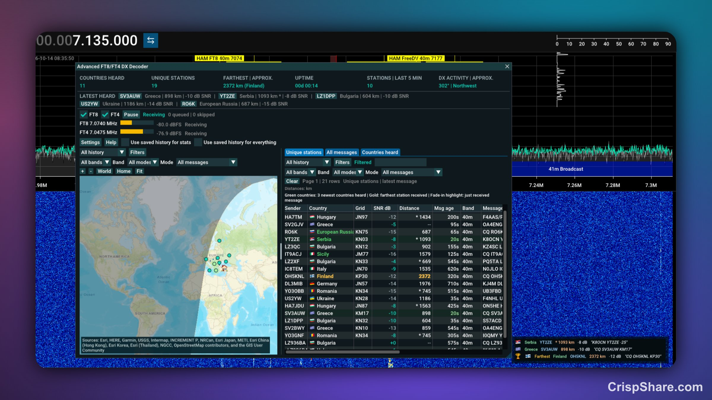
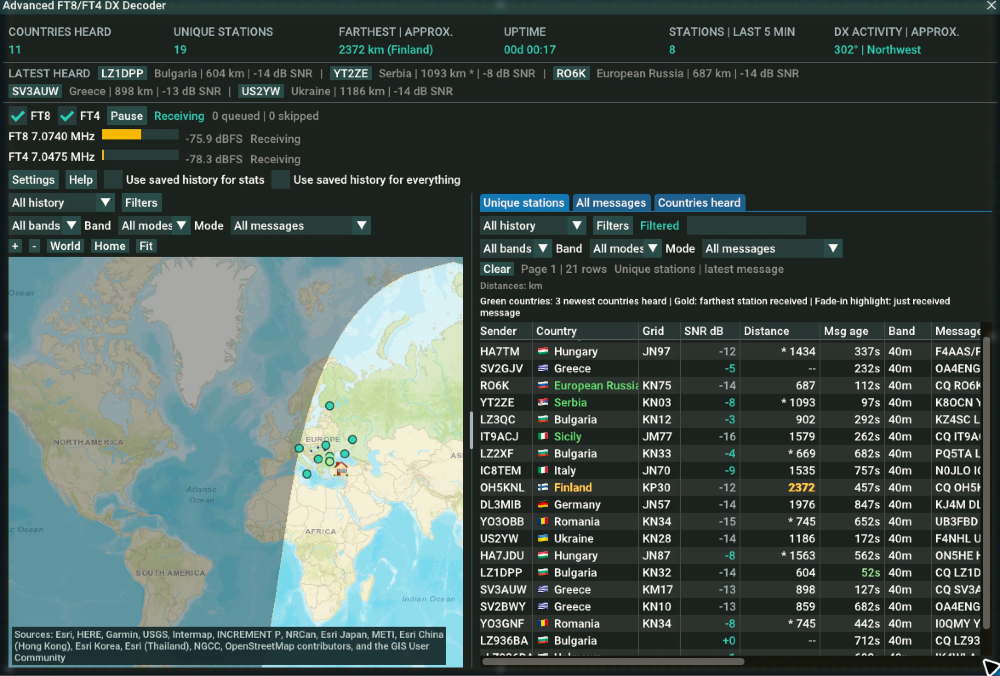

# Advanced FT8/FT4 DX Decoder

**FT8 and FT4 decoding, a DX map, and reception logging inside SDR++ and SDR++Brown for macOS.** See the stations you hear, their countries, receiver SNR, approximate distances and recent exchanges without opening a separate mapper.

Created by [ReLLL](https://github.com/ReLLL). Free software under GPL-3.0-or-later.

## Download and install

[Download the latest release](https://github.com/ReLLL/advanced-ft8-ft4-dx-decoder/releases/latest). The installer supports **both SDR++ and SDR++Brown** on **Apple Silicon Macs running macOS 15 or later**. Verified hosts: **SDR++ 1.2.0, May 28, 2024 build** and **SDR++Brown 1.2.1, August 4, 2026 build**. Both were tested on macOS 26. Other host builds may require matching binaries; the installer checks compatibility automatically.

1. Install [SDR++](https://github.com/AlexandreRouma/SDRPlusPlus/releases/tag/nightly) or [SDR++Brown](https://sdrpp-brown.san.systems/) in **Applications**. Skip this if you already have the supported app installed.
2. Download and open `installer-macos-arm64.dmg`, then open **Install Advanced FT8-FT4 DX Decoder**. The ZIP includes the same installer if you prefer to extract it.
3. The installer detects the installed radio app. If both are installed, choose the one you want. Confirm your **Home locator** if you know it; an existing locator is prefilled. Click **Install**. First-run settings are prepared automatically if needed; an open host is asked to quit normally before its configuration is updated.
4. Click **Open SDR++** or **Open SDR++Brown**. Open **Advanced FT8/FT4 DX Decoder** from the sidebar.
5. If you skipped the home locator, set your actual **Maidenhead grid** before relying on distances and bearings. In **Brown**, expand the left **Source** panel and find **My Grid** below **Operator Callsign**. Enter a four- or six-character locator; Brown shows coordinates beside a valid grid, or **Invalid**. In **standard SDR++**, open the plugin's **Settings > General > Maidenhead grid**; four, six or eight characters are accepted. For example, `KM69` and `KM69xx` show the format; use your own locator. More characters give a smaller location area. Distances and bearings use the grid center. Standard SDR++ keeps distances and the home marker unavailable until a valid home locator is configured.
6. Start your SDR and tune a capture covering an FT8 or FT4 dial frequency. Eligible presets show **Receiving**.

No Python, Terminal, Homebrew, developer tools or administrator password is needed for the native installer. It verifies packaged files and the selected host build, backs up the configuration and any previous plugin, and installs outside the host's signed application. Each host has its own binary, profile and reception history. Settings and logs are preserved; **Choose profile...** supports a non-default profile. [Installation and removal](docs/INSTALL.md).

The **SDR++ build uses standard SDR++ APIs**, with its own location and country data; it does not require Brown to be installed. Brown keeps its native integration and existing behavior. The shared FT8/FT4 decoder uses pinned MSHV-derived source, while host headers and runtime libraries match the selected application.

## What you can see in 1.0.25

- **At a glance:** unique countries, unique stations, farthest distance with country, active decoding uptime, stations heard in the last five minutes, and the latest five calls with country, distance and receiver SNR.
- **Three reception views:** Unique stations, All messages and Countries heard. Repeated messages stay visible in All messages; country summaries show distinct senders, mean distance/SNR and the last five senders. Each table remembers its layout and sort.
- **Waterfall corner:** optional, initially on. Every new reception appears with its flag, country, sender, distance, SNR and full italic message, including repeats. Rows pulse for two seconds and expire after an adjustable 10 seconds. The farthest reception stays below, with a trophy and flag; only its Farthest label is gold.
- **Flags and details:** flags precede country names in all tables. The details pane separates station, country, distance, signal and message colors. Double-click a country to see all its matching receptions, including repeats, newest first.
- **Distance units:** kilometers by default, with a saved miles option in General settings. Tables, map tips, statistics, details, notifications and distance filters follow this choice.
- **Flexible workspace:** resizable window, visible map/table splitter, sortable columns with saved drag order, widths and visibility, map-only and table-only views. Newest **Station first heard** comes first by default; repeats retain the original first-heard time.
- **Message detail:** callsign, country, grid, band, FT8/FT4 mode, SNR, approximate distance, message text, Msg age, Msg first heard and Station first heard. One row per callsign across bands and modes, with the latest matching message and receiver values. Hover reveals UTC timestamps; right-click opens Google, QRZ or HamQTH for the transmitting or addressed station.
- **DX map:** Esri street map by default, Humanitarian OpenStreetMap or bundled offline world map. Country names, day/night shading, home marker, optional faint country highlights, and dark-blue animated dotted arcs between addressed stations with received location evidence.
- **Focused reception:** separate or linked band/mode filters, CQ/general-call and two-way message filters, search, exclusions and time windows. Sender, Target and Mod identify the transmitter, addressed callsign and latest FT8/FT4 mode; numeric ranges cover every signal, age and reception-count column.
- **Clear visual feedback:** nine-second reception highlight, latest-batch map halos and green age values, green country cells for the three most recently discovered countries, retained across message updates, and bold gold for the farthest station's country and distance.
- **Persistent logs:** UTF-8 CSV with UTC dates, callsigns, SNR, frequency, distance and message details. Commas, quotes and line breaks are escaped. Choose the file location and size limit in Settings.
- **Optional GridTracker feed:** direct local UDP using WSJT-X packets, initially off, with `127.0.0.1:2237` ready to enable. No separate bridge is required for this feed.
- **Quiet defaults:** alert sounds, map marker counts and both saved-history options start off. Individual alert sounds are selectable.

Closing the decoder window keeps reception, logging, alerts and integrations running while the sidebar switch is on. Open brings the window forward with current data and preserves its size and position. Each host starts with empty visible views and fresh session statistics by default. **Use saved history for stats** includes retained receptions in the totals. **Use saved history for everything** also restores the map, table and first-heard times. Both start off and load in the background; uptime always measures this session's active decoding. Live reception, table/map updates and logging continue while history is enabled. Clear asks for confirmation and preserves saved logs. Its checked **Reset stats** option returns to session mode and turns off both history options.

Map markers and table rows share station actions. Ignore transmitter accepts unresolved and malformed identities, asks for confirmation, then deletes matching saved receptions and blocks future ones; statistics update in the background. Rows with no transmitter identity can ignore that exact message without deleting unrelated unknown messages. Unignore allows future receptions without restoring deleted records.

## Screenshots

Live reception in SDR++Brown, showing the DX map, reception tables, country flags and waterfall notifications.

## Read the numbers correctly

Distance uses the great-circle path between your home grid center and a received station grid center. `*` before a distance marks recent cached grid evidence. A missing grid stays unknown; a callsign prefix identifies a DXCC entity rather than an exact transmitter location.

**DX activity bearing** summarizes short-path bearings from home to the farthest recent stations. It describes observed reception activity, not measured arrival direction or a propagation forecast. An addressed message and an arc do not prove a completed contact.

[User guide](docs/USER_GUIDE.md) explains the columns, colors, settings, map cache, scientific limits and GridTracker setup. The same essentials are available in the plugin's **Help** dialog.

## CPU and memory

Measured on an Apple M2 Max with 12 cores and 32 GB RAM, receiving 40m FT8 and FT4 from a 3.2 MS/s SDR capture. Each state ran for about 60 seconds with the same 1512 x 921 Brown window. Totals include Brown and the decoder helper.

| State | Average CPU | Average memory |
| --- | ---: | ---: |
| Plugin unloaded | 30.5% | 576 MB |
| Decoding, window closed | 34.6% | 901 MB |
| Decoding, map and tables visible | 47.5% | 873 MB |
| Sidebar switch off after decoding | 28.4% | 941 MB |

100% CPU means one core. Memory is macOS physical footprint in decimal MB. These are short measurements on quiet live RF; decoding load, map rendering and caches affect the results. Closing the window reduced CPU while reception continued. Switching the plugin off stopped decoding but retained an idle helper and cached memory; unloading it is a different state. The active helper averaged about 1% CPU and 277 MB. No separate mapper helper was used; GridTracker and the legacy decoder were off.

## Build and contribute

See [building and releasing](docs/RELEASING.md). The decoder uses pinned SDR++Brown/MSHV code, with FFT plan lifetime fixes. History uses SQLite, native dialogs and sound use AppKit, and polygon triangulation uses Mapbox Earcut. [Third-party notices](THIRD_PARTY_NOTICES.md).

Report bugs through [GitHub Issues](https://github.com/ReLLL/advanced-ft8-ft4-dx-decoder/issues). Include plugin version, Brown build, macOS version, reproduction steps and relevant messages. Review logs and screenshots for private information before sharing.
